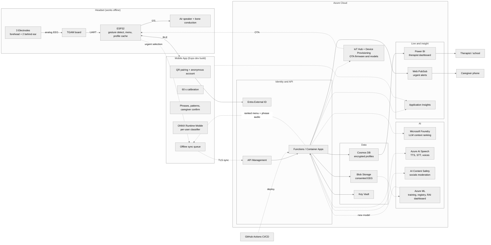

# [Project Name]: EEG Communication Headset

A wearable that helps non-verbal people, including autistic children and adults, tell their caregivers what they need, out loud.

A non-invasive headset reads a single channel of biosignals (blinks, jaw clenches, eyebrow raises) and uses them as a reliable switch. A predictive AI layer ranks the most likely needs from time of day, routine, and history, so one gesture is often enough to speak a phrase through the headset's speaker.

> Microsoft Imagine Cup project. Status: early prototype.

> **Not a medical device.** This is an assistive communication tool. It does not diagnose, treat, or read thoughts.

---

## The Problem

Many non-verbal people understand far more than they can express. Existing communication aids are often slow, expensive, or need motor control that some users don't have. Caregivers are left guessing.

## Our Approach

1. **Wear it.** A lightweight adjustable headband with three electrodes: one on the forehead and two behind the ears (reference and ground).
2. **Signal it.** The wearer makes a simple gesture they can control, such as a double blink.
3. **Speak it.** The headset plays a stored phrase (for example "I'm thirsty") through an air speaker for the caregiver, with optional bone-conduction feedback for the wearer.
4. **Predict it.** Cloud AI reorders the phrase menu using context, so the most likely need comes first. This runs ahead of time, so speaking never waits on the internet.

## Key Features

- Works offline on the headset itself
- QR-code setup and automatic Bluetooth pairing, with an anonymous account created for you
- 60-second guided calibration (blink 3 times, double blink, clench, and so on)
- Custom gesture-to-phrase mappings
- Caregiver confirmation for high-stakes phrases
- Phrases in a familiar voice
- Caregiver alerts for urgent selections
- Therapist and school dashboard

## Honest Technical Scope

This is a **single-channel** system. It cannot decode specific thoughts. It detects voluntary eye and facial-muscle signals plus basic brain-rhythm features, and turns them into a dependable switch. The "intelligence" comes from software: personalization, prediction, and context. Multichannel decoding is on the roadmap, not in the MVP.

---

## System Architecture



**How to read it:** solid arrows are the real-time loop on the headset. Dashed arrows are asynchronous: sync, model updates, and the ranked menu coming back down.

---

## Hardware

| Component | Purpose |
|---|---|
| 3x sintered Ag/AgCl disc electrodes | Forehead sensing, reference and ground behind the ears |
| TGAM board | Single-channel EEG front end (UART output) |
| ESP32 dev board | Gesture detection, menu logic, audio, BLE |
| 2x MAX98357A I2S amplifier | Audio output to speaker and transducers |
| Air speaker (8 ohm) | Speaks to the caregiver |
| 2x bone conduction transducers (8 ohm, 1.5 W) | Optional feedback to the wearer |
| 3.7 V 1800 mAh protected LiPo | Power |
| TP4056 USB-C charging board (with protection) | Charging |
| Toggle switch, 10 mm RGB LED | Power and status |
| Optional: MPU6050 accelerometer | Head-nod fallback input |

**Design notes**
- Adjustable headband: rigid front half plus a sliding rear half, sized for roughly 480 to 620 mm head circumference
- Behind-ear electrodes ride on a sliding rail along a riding-bow arm so they fit kids and adults
- Charge lockout: the headset is disabled while USB is connected
- Amps and radio are kept away from the electrode leads to reduce noise

## Gestures and Calibration

Planned gesture set: single blink, double blink, jaw clench, eyebrow raise, eyes-closed hold.

On first use, the app runs a 60-second guided calibration with a big countdown, icons, and sound for each action. It picks the gesture with the cleanest separation from rest as the default selector, and users can skip any step. A dwell or repeat rule reduces accidental triggers. The key metric is **false triggers at rest**, not just hit rate.

## Machine Learning Plan

1. Rule-based blink and clench detection on the raw TGAM signal
2. Lightweight classifier (random forest or small 1D CNN) on statistical and band-power features
3. Prototyping on public datasets (for example the Glasgow "EEG during everyday tasks" single-channel set), then fine-tuning on our own consented TGAM recordings
4. Per-user adaptation from caregiver confirmations
5. Later: evaluate single-channel foundation-model embeddings against the simple baseline

## Microsoft Services

| Layer | Service |
|---|---|
| Identity | Microsoft Entra External ID |
| API | Azure Functions or Container Apps, API Management |
| Data | Cosmos DB, Blob Storage, Key Vault |
| AI | Microsoft Foundry, Azure AI Speech, Azure AI Content Safety, Azure Machine Learning |
| Devices | Azure IoT Hub, Device Provisioning Service |
| Live and insight | Web PubSub, Power BI, Application Insights |
| On-device ML | ONNX Runtime Mobile |
| DevOps | GitHub Actions |

## Privacy and Responsible AI

- EEG is biometric data. Nothing is collected without explicit consent.
- Caregivers control the wearer's profile. The wearer does not need an account.
- Profiles are encrypted. Training uses opt-in, de-identified data only.
- Any shared phrase content is moderated with AI Content Safety.
- We report how well the system works for different head sizes, hair types, and ability levels.

## Roadmap

- [ ] Hardware prototype: headband, electrodes, firmware
- [ ] Gesture detection and 60-second calibration
- [ ] Mobile app with QR pairing
- [ ] Azure backend and predictive menu
- [ ] Pilot with real users, caregivers, and therapists
- [ ] Multichannel upgrade (ADS1299-class front end)

## Repository Layout (planned)

```
/hardware   CAD files, wiring, bill of materials
/firmware   ESP32 code
/app        Expo mobile app
/backend    Azure functions and infrastructure
/ml         datasets, training, evaluation
/docs       architecture and design notes
```

## Contributing

Issues and suggestions are welcome. Please do not commit real EEG recordings, personal data, or credentials.

## License

[Choose a license]

## Team

[Names, roles, and contact]
